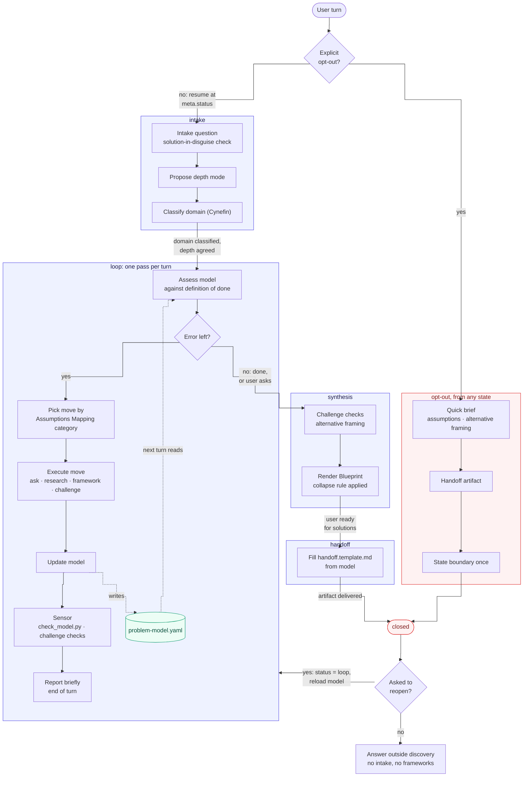

# The problem-space-discovery harness

`problem-space-discovery` is built as a harness, not a free-form conversation. It
has a defined state (the problem model), defined rules (the control loop and its
checks) and a defined output (the Blueprint or the handoff). It enters, runs,
hands off and exits, and never operates outside those rules.

It helps to read it as a feedback control system:

| Control element | In the harness |
| --------------- | -------------- |
| Setpoint | The definition of done in `SKILL.md` |
| Plant (the state being controlled) | The problem model, `problem-model.yaml` |
| Sensor | `scripts/check_model.py` and the challenge checks |
| Error signal | Test-first and test-next assumptions, unmet definition-of-done criteria, unresolved contradictions |
| Controller | Move selection, ranked by Assumptions Mapping category |
| Actuator | The move: ask, research, apply a framework, challenge, synthesise |
| Supervisor | The state machine in `meta.status`: `intake`, `loop`, `synthesis`, `handoff`, `closed` |

The inner loop runs once per turn. Each move changes the model, the sensor
reads the model back, and the next turn's assessment works on what changed.
That feedback is why the skill keeps an explicit model rather than relying on
prose. The supervisor decides which part of the harness a turn enters. It also
provides the two ways out: the normal path through synthesis and handoff, and
the opt-out, which can be taken from any state.

## Control flow

## Why the exits matter

A discovery skill without a clean exit tends to keep doing discovery: when the
user opts out, it soft-refuses, and when the user asks a solution question after
the handoff, it starts intake again. The `closed` state fixes both. Once the
handoff is delivered, the harness gives up control until the user asks to
reopen it, and reopening resumes the loop on the saved model instead of
starting over.

## Why one prioritisation method

The controller ranks moves by a single rule, Assumptions Mapping with a fixed
importance test, so two runs on the same model choose the same next move. A
judgment-based ranking makes the loop's behaviour depend on phrasing rather
than on the model. The principle behind the rule is the value of information:
research is worth doing only if its result could change the definition.
